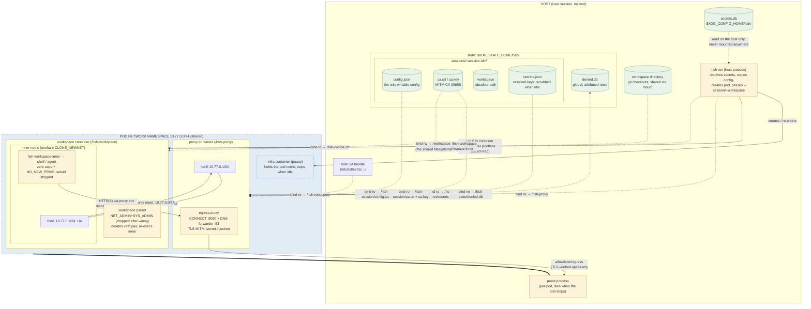

# hsh architecture

hsh runs an interactive shell inside a rootless podman sandbox with
controlled egress. It is a single static Go binary that plays three roles:

| Mode | Runs | Purpose |
|---|---|---|
| `hsh run` | on the host | loads config, creates the pod and containers, attaches to the workspace |
| `/hsh-proxy` | proxy container, inside the pod | egress proxy: network policy (https/allowlist/none), TLS interception, secret injection |
| `/hsh-workspace` / `/hsh-workspace-inner` | workspace container, inside the pod | network isolation setup, then the user's shell |

Host-side subcommands manage state around the sandbox: `hsh secret`
(the secret store below), `hsh proxy` (denial review) and `hsh monitor`
(the review TUI), and `hsh ls`/`hsh rm` (sandbox lifecycle).
`hsh version` prints the release tag, git commit, and platform. The tag
is stamped by the release workflow with
`-ldflags "-X hsh/internal/version.Tag=$GITHUB_REF_NAME"`; local builds
report `dev` plus the VCS commit (`-dirty` with uncommitted changes).

The same binary is bind-mounted read-only under role-named paths in the
containers (`/hsh-proxy` in the proxy, `/hsh-workspace` and
`/hsh-workspace-inner` in the workspace) and used as the container
entrypoints; the role is dispatched on argv[0], so the container plumbing
is not part of the user-facing command set. The `proxy`, `workspace`, and
`workspace-inner` subcommand names remain as aliases (and keep
`--resume` sessions created before the rename re-attachable).

## Pod layout

`hsh run` creates one podman pod (a session) with two containers — the
diagram shows the network namespaces, the user-namespace mapping, and
every bind mount:



Reading notes:

- **Two network namespaces**: everything of the pod shares one netns
  (infra, proxy, workspace parent); the shell runs one netns deeper —
  `/hsh-workspace-inner` calls `unshare(CLONE_NEWNET)` and the parent
  moves the `hsh1` veth end into it. The only route out of the inner
  netns is the veth to the proxy; direct egress fails at the TCP layer.
- **User namespace**: rootless podman — container uid 0 maps to the
  invoking host user (subuid mapping). The parent process briefly holds
  NET_ADMIN/SYS_ADMIN to wire the veth pair, then drops all
  capabilities; the inner process keeps only CAP_DAC_OVERRIDE (overlayfs
  needs it to create new entries — whiteouts and directory copy-up — in
  image-layer directories; without it `dnf`/`rpm` unpacks fail with
  "cpio: symlink failed - Permission denied"), sets NO_NEW_PRIVS, and
  setuid binaries are stripped from the workspace.
- **Filesystem**: solid edges are network/data flow, dashed edges are
  bind mounts. The session directory is mounted read-only into the
  proxy only (config copy, resolved secrets, CA); the workspace sees
  only the CA certificate. `secrets.json` never enters the workspace.
- Pods do not share PID namespaces, so the workspace cannot see or
  signal the proxy's processes.
- **Idle**: when the shell exits the whole pod is stopped (infra and
  proxy included, killing the pod's pasta process) and `secrets.json`
  is unlinked from the session directory.

## Network isolation

The workspace container starts in the pod's network namespace with
`NET_ADMIN` and `SYS_ADMIN` capabilities. Its entrypoint
(`/hsh-workspace`):

1. creates a veth pair (`hsh0`/`hsh1`) in the pod network namespace and
   configures `hsh0` with `10.77.0.1/24`
2. re-executes `/hsh-workspace-inner`, which calls
   `unshare(CLONE_NEWNET)` to move into a fresh, empty network namespace
3. moves `hsh1` into the child's namespace (by PID, via netlink)
4. drops all of its own capabilities
5. signals the child, which configures `hsh1` with `10.77.0.2/24` and brings
   up loopback

The child namespace has exactly one route: `10.77.0.0/24 dev hsh1`. There is
no default route, so the workspace cannot reach the internet, the host, or
any other network directly. Its `/etc/resolv.conf` points at the proxy
(`10.77.0.1`), where a DNS forwarder runs (see below), so names resolve only
when allowlisted — but resolved names still cannot be reached directly.

The child then:

- installs the proxy CA into `/etc/ssl/certs/ca-certificates.crt`
- creates the home directory, strips setuid/setgid bits from the container
  filesystem (excluding the workspace mount)
- drops all capabilities except CAP_DAC_OVERRIDE and sets `PR_SET_NO_NEW_PRIVS`
- `chdir`s into the workspace and `exec`s the configured shell. When the
  config's `agent.launch` is set and the shell is bash, the shell is
  exec'd with `--rcfile` pointing at a generated rcfile (job control
  enabled via `set -m`, standard rcfiles sourced, then the launch argv
  run as a foreground job): interactive sessions auto-launch the agent
  harness, Ctrl-Z suspends it into the shell, and non-interactive
  sessions skip it because bash only reads the rcfile when interactive

The shell runs as container uid 0, which rootless podman maps to the invoking
host user, so files written to mounted directories are owned by the host
user. With only CAP_DAC_OVERRIDE effective and `NO_NEW_PRIVS` it cannot
modify routes, create namespaces, or regain privileges through setuid
binaries; CAP_DAC_OVERRIDE only bypasses file-permission checks inside the
sandbox's own filesystem (the kernel requires it for overlayfs copy-up when
creating files in image-layer directories — package installation needs it,
an ordinary `podman run --cap-drop=ALL` fails the same way).

The workspace parent process (container PID 1) also drops its capabilities
after moving the veth, so it cannot be ptraced for privileges either.

## Egress proxy

The proxy listens on `10.77.0.1:8080` — the only address the workspace can
reach. The workspace shell gets `http_proxy`/`https_proxy`/`all_proxy`
(plus uppercase variants) pointing at it, and `no_proxy` for loopback and
the veth addresses.

Every request is checked against `network.allow`:

- **Denied**: the proxy answers `407 Proxy Authentication Required` with a
  `Proxy-Authenticate: Hsh realm="egress-allowlist"` header (RFC 7235)
  and records the host in the denial database. For `CONNECT` this surfaces
  in curl as `CONNECT tunnel failed, response 407`.
- **Allowed, no secret configured for the host**: the proxy tunnels the
  connection (`CONNECT` → `200 Connection Established`, then a raw TCP
  splice). TLS is end-to-end between the workspace and the upstream; any
  protocol works.
- **Allowed, secret configured for the host**: the proxy intercepts.
  `CONNECT` is answered with `200`, the proxy terminates the client's TLS
  with a per-host certificate signed by the run's CA, reads the HTTP
  request, injects the configured headers, and forwards the request
  upstream over a fresh verified TLS connection. Responses stream back.

Plain-HTTP proxy requests (absolute URIs) are forwarded the same way, with
injection applied when the host matches a secret.

Host matching is case-insensitive, ignores a trailing dot, and supports
`*.example.com` wildcards (matching one or more leading labels).

### DNS

The workspace's `/etc/resolv.conf` points at the proxy (`10.77.0.1`), where
a DNS forwarder (UDP and TCP 53) runs alongside the HTTP proxy. Query names
are matched against `network.allow` with the same rules as HTTP: allowed
names are forwarded to the pod's upstream resolvers (from the proxy
container's `/etc/resolv.conf`), everything else gets `REFUSED`.

Because the workspace has no route beyond the veth, resolved names still
cannot be reached directly — local DNS feeds tools that resolve before
connecting through the proxy, and debugging (`getent`, `nslookup`). The
policy matters: an unrestricted resolver would let the workspace exfiltrate
data via DNS tunneling without ever opening a TCP connection the proxy
could check.

DNS denials are recorded in the same `denied` table as egress denials —
there is no separate DNS ledger and no separate DNS policy: a refused
lookup and a refused CONNECT are both "the agent tried to reach X", one
review queue, one approval per host (approving a host fixes the lookup
and the egress together). A merged row is keyed by host + session, so
`count` aggregates denial events of either kind and `target` keeps the
first-seen form (`host:443` from a CONNECT, `name:53` from a lookup).
Databases from before the merge are migrated on open: `dns_denied` rows
fold into `denied` (counts bumped on collision) and the table is
dropped.

### Denial database

Every denial is recorded in a SQLite database (modernc.org/sqlite — pure Go,
so the `CGO_ENABLED=0` static build is unaffected) at
`$XDG_STATE_HOME/hsh/denied.db` (default `~/.local/state/hsh/denied.db`,
override with `hsh run --denied-db PATH`). The database is opened in WAL
mode with a busy timeout, so the proxy (writer) and the CLI (reader) can use
it concurrently, including across simultaneous sessions.

The database is global: rows from every session and workspace land in one
review queue, attributed per row — `hsh run` passes the session id and the
workspace path to the proxy container (`--session`/`--workspace` on
`hsh-proxy`), and both are stored on each row of the single `denied` table
(keyed by host + session). `hsh proxy denied` and `hsh monitor` filter
on `--session`/`--workspace`; `hsh proxy allow` takes a `--session` and
writes that session's config copy, so one session's approvals never
leak into another session's policy.

```sql
CREATE TABLE IF NOT EXISTS denied (
    host       TEXT NOT NULL,
    session    TEXT NOT NULL DEFAULT '',
    workspace  TEXT NOT NULL DEFAULT '',
    target     TEXT NOT NULL,   -- host:port as requested
    count      INTEGER NOT NULL,
    first_seen TEXT NOT NULL,   -- RFC 3339, UTC
    last_seen  TEXT NOT NULL,
    allowed    INTEGER NOT NULL DEFAULT 0,
    allowed_at TEXT,
    ignored    INTEGER NOT NULL DEFAULT 0,
    PRIMARY KEY (host, session)
);
```

Recording is an upsert on host + session (count incremented,
`last_seen` bumped); `allowed` marks rows already handled. Egress
denials (a refused CONNECT) and DNS denials (a refused lookup) share the
table — see the DNS section above. The state directory is bind-mounted
read-write into the proxy container only — the workspace never sees it,
so the agent cannot erase or forge its own denial record. Database
errors are logged and never change the response: a denial is a denial
with or without the log.

The host-side commands work with the database:

```
hsh proxy denied [--session ID] [--workspace PATH] [--watch]   list the queue
hsh proxy allow --all --session ID [--watch]                   allow every pending host
hsh proxy allow --session ID https://example.com [--watch]    allow one host
hsh monitor [--session ID] [--workspace PATH] [--all]         interactive review (TUI)
```

`proxy denied` prints pending rows (`allowed = 0`) as a table (session
id, workspace, URL, count, last seen, sorted by count); a
`--session`/`--workspace` filter narrows the output to bare URLs;
`--watch` continuously prints new denials. `proxy allow` writes hosts
into the session's config copy (`network.allow`), prints
`added https://<host>` (or `already allowed`), and marks the rows
allowed so they leave the queue — trust on first use: the first attempt
is denied and recorded, review allows it, running proxies hot-reload
the config within ~1s. `--all` approves everything pending for the
session; a URL argument allows a single host (the URL is normalized to
its hostname). `--watch` keeps approving new denials as they appear.

`monitor` is the interactive counterpart (bubbletea/bubbles TUI,
requires a terminal, runs full-screen in the alternate screen buffer):
a multi-select table of pending denials — SESSION, WORKSPACE, URL,
COUNT, LAST SEEN, in that order — most recently requested first,
refreshed live every 2s. `--session`/`--workspace` scope the view (the
title shows the active scope) and the columns fill the terminal
width. Keys: `space` select the cursor row, `a`/`n` select/clear all,
`enter` approve the selected hosts (added to the session's
`network.allow`, marked allowed), `i` ignore them (marked handled
without allowing), `t` toggle a view of ignored rows (marked
"(ignored)", not selectable), `/` filter the table live while typing
(matches session ids, workspaces, and hosts; `tab` completes the input
against sessions, workspaces, and hostnames — unique matches fill in,
ambiguous ones extend to the common prefix and list the candidates in
the status line; `enter` keeps the filter, `esc` clears it), `r`
refresh, `↑/↓/j/k` navigate, `q` quit. Keys: `space` select,
`a`/`n` select/clear all (ignoring any active filter), `/` filter,
`enter` approve the selected hosts (added to the session's
`network.allow`, marked allowed), `i` ignore them (marked handled
without allowing: they leave the review list permanently), `t` toggle a
view of ignored hosts (dimmed, non-selectable), `r` refresh, `?` help,
`q`/`esc`/`ctrl+c` quit.

## Secret injection

Secrets are declared in the config as `secrets.<NAME>` with:

- `from`: a reference URL — `env://VAR` (host environment variable,
  also written as a bare `VAR`), or `hsh://NAME` (the hsh secret store;
  see below). Unknown schemes fail at config load.
- `hosts`: hosts the secret may be injected for
- `header` (optional): header name; defaults to the secret name with `_`
  replaced by `-` (e.g. `API_KEY` → `Api-Key`)
- `prefix` (optional): prepended verbatim to the value (e.g. `"Bearer "`)

The flow keeps the secret out of the workspace entirely:

1. `hsh run` resolves the references (`os.Getenv` for `env://`, the
   secret store for `hsh://`) and writes the values
   to `secrets.json` in a temporary directory (mode 0600)
2. the temporary directory is bind-mounted read-only into the **proxy
   container only** — the workspace container never sees it
3. the proxy injects `header: prefix+value` into requests whose host matches
   `hosts`, replacing any value the workspace sent

The workspace cannot read the proxy container's files (different container,
private PID namespace, root-owned 0600 file), cannot redirect an injected
request to another host (the proxy dials the `CONNECT` target itself), and
the proxy logs header names but never values.

### The hsh secret store

`hsh secret add/rm/ls` manage a first-party store so users stop
hand-editing configs or exporting keys into their shell environment:

- a SQLite database at `$XDG_CONFIG_HOME/hsh/secrets.db` (directory
  `0700`, file `0600`, plaintext values — the same trust level as
  `~/.netrc`; a first-use note warns about it)
- `secret add NAME` prompts with echo disabled (or `--value-stdin` for
  scripting); there is deliberately no `--value` flag, since values on
  the command line leak into shell history and the process list
- `secret add --host/--header/--prefix` also writes the
  `secrets.<NAME>` config entry with `from: "hsh://NAME"`
  (RawMessage-preserving rewrite, like `hsh proxy allow`)
- `secret rm` warns when the config still references the entry but never
  edits the config; `secret ls` prints names and timestamps, never values
- only the host-side `hsh run` process and the `secret` subcommands touch
  the store; the store lives on the host and is never mounted into the
  sandbox. A missing entry behaves exactly like an unset environment
  variable: a warning, and the secret is skipped.

The scheme-based `from` makes further backends (OS keyrings, `dotenv`,
password managers) a scheme-registration addition without changing the
config format or the proxy; the model is nono.sh's credential injection
(https://nono.sh/docs/cli/features/credential-injection).

## TLS interception

`hsh run` generates a fresh ECDSA P-256 CA per session; it is persisted in
the session state (`$XDG_STATE_HOME/hsh/sessions/<session-id>/ca.key`,
mode 0600) so the CA the workspace trusts stays stable across re-entries,
and it is never written anywhere else. The CA certificate is bind-mounted into the
workspace (which appends it to the system trust bundle and exports
`SSL_CERT_FILE`, `GIT_SSL_CAINFO`, `NODE_EXTRA_CA_CERTS`,
`CURL_CA_BUNDLE`, `REQUESTS_CA_BUNDLE`); the CA private key is mounted
into the proxy container only. The proxy signs per-host leaf certificates
on demand (cached per host).

Upstream TLS is verified against the host's CA bundle (bind-mounted into the
proxy container, falling back to the image's bundle).

Interception is required for secret hosts and is a deliberate design
decision, not a gap: injecting a header into an HTTPS request means
terminating TLS, and the secret must never enter the workspace. Hosts
without secrets are tunneled end-to-end instead. The known costs are that
the proxy can read and modify all traffic to intercepted hosts, non-HTTP
protocols to those hosts break, and clients that use their own CA bundle
need a per-client CA variable (see docs/sandboxed-oauth.md).

## Configuration hot reload

The proxy polls the config file and the resolved-secrets file once per
second and swaps its in-memory state when either changes. `hsh run`
likewise watches the config file and rewrites `secrets.json` when it
changes, so `network.allow` and secret values/hosts update without
restarting the sandbox. Both files are reached through **directory**
bind mounts so that replacing the file (editors and `sed -i` rename files)
is picked up.

Mounts, image, and shell changes require a restart.

## Lifecycle and cleanup

- Progress information (pod creation, workspace start, config reloads) is
  suppressed by default so the sandbox starts with a clean terminal prompt;
  pass `--verbose` (or set `HSH_VERBOSE=1`) to see it on stderr.
  Warnings and errors are always printed.
- The pod is named `hsh-<random>`; containers are `<pod>-proxy` and
  `<pod>-ws`. Every hsh pod carries the label
  `hsh.workspace=<first mount source>`, so the workspace a sandbox
  belongs to is always discoverable.
- `hsh run` attaches to the workspace container (`podman run -it`, or
  `-i` when stdin is not a terminal) and propagates its exit code.
- On exit, SIGINT, or SIGTERM, the pod is removed (`podman pod rm -f`) and
  the temporary directory deleted.
- Proxy logs: `podman logs <pod>-proxy` while the session is running.

A killed or crashed `hsh` does not get to remove its pod, so sandboxes
can be left behind. `hsh ls` and `hsh rm` find and clean those up; both
operate on pods whose name contains `hsh-` and follow the flags and
semantics of `podman pod ls` / `podman pod rm`:

```
hsh ls                                    # SESSION first (usable with --session, --resume, rm), then status and WORKSPACE
hsh ls -q --sort name                     # quiet, sorted
hsh ls --workspace ~/repo                 # the sandbox for one workspace
hsh rm 53bd3fc7e5ba                       # remove a leftover by session id (refuses if running)
hsh rm -f hsh-53bd3fc7e5ba                # stop running containers, then remove
hsh rm ~/repo                             # remove via the workspace path
hsh rm --all -f                           # full cleanup
```

`hsh rm` passes the usual podman flags through (`-f/--force`,
`-t/--time`, `-i/--ignore`, `-l/--latest`, `-a/--all`). A sandbox with
running containers is refused without `--force`, exactly like
`podman pod rm`. Removing a sandbox also removes its session state
directory, and `rm --all` sweeps everything. `hsh gc` collects session
state directories whose pod is already gone. Pods that are not hsh
sandboxes are never touched.

## Sessions and workspaces

A **session** is one podman pod (name `hsh-<12 hex>`; the suffix is the
session id) plus its state directory
`$XDG_STATE_HOME/hsh/sessions/<session-id>/`:

```
config.json   the session's config copy — the only writable config
ca.crt ca.key the session's MITM CA, stable across re-entries
workspace     file with the absolute path of the workspace
```

A **workspace** is the host directory the first mount sources from
(recorded as the pod label `hsh.workspace`); there may be several
sessions per workspace.

- Every `hsh run` creates a persistent session. The seed config
  (`--config PATH`, or `./config.hsh`, or the image's `org.ifup.hsh`
  label) is copied into the session directory with mounts resolved to
  absolute paths; the copy is the live config — watched for hot reload,
  and the only file the review commands edit.
- When the shell exits the whole pod is stopped (proxy and infra
  included — verified: `podman start` auto-starts the infra container,
  so re-entry needs no extra handling) and the resolved `secrets.json` is
  scrubbed from the session directory: an idle session holds no key
  material. Re-entry re-resolves secrets from the session config.
- **Detach and attach** use podman's own flow. Interactive sessions run
  the podman client with `--sig-proxy=false --detach-keys=<detach_keys>`
  (default Ctrl-]; podman's Ctrl-P Ctrl-Q is disabled). Detaching, or
  closing the terminal, ends only the podman client; conmon keeps the
  container's pty, so the shell and agent keep running, and
  `hsh run --resume` runs `podman attach` to the same shell. When the
  client returns and the workspace container is still running, `hsh run`
  reports the detach and leaves the pod, proxy, and `secrets.json` alone.
  Output produced while detached is not replayed, and the screen is not
  repainted until the shell redraws (Ctrl-L). `--rm` and `--tasks`
  sessions, and non-terminal runs, cannot detach.
- **The reaper** (`hsh-reaper`, the same binary under another `argv[0]`)
  is started detached from the terminal (`setsid`) whenever an
  interactive session is attached. It waits for the workspace container
  to exit and then runs the same idle cleanup (`secrets.json` removed,
  pod stopped), so a shell that exits while detached does not leave the
  proxy running with resolved secrets. One reaper per session (a
  `reaper.lock` flock in the session directory); `hsh run` also runs the
  cleanup itself when it sees the container exit. While no `hsh run` is
  attached, edits to secret entries in the session config are picked up
  on the next attach.
- **The relay.** An interactive session is attached through a pty owned by
  `hsh run` (`internal/relay`): `hsh run` runs the podman client with the
  pty slave as its terminal and relays between it and the user's raw
  terminal. Output is passed through unchanged and also fed to a terminal
  emulator (`internal/vt`, libghostty-vt compiled to wasm and converted to
  Go, built with `GOEXPERIMENT=simd`). The emulator tells the relay when the
  stream is between escape sequences (so the status line and dialog are
  never injected mid-sequence) and lets it repaint the session screen after the
  review screen closes. The pty is one row shorter than the terminal and the
  terminal's scroll region excludes the last row; the relay rewrites a
  child's scroll-region resets (`ESC[r`) to stay inside it and repaints the
  row after `clear` or alternate-screen switches. The review screen is the
  `hsh monitor` bubbletea model (`internal/tui/proxywatch`) filtered to the
  session; the relay drives it directly (key parsing, running its commands,
  drawing its `View()` over every row) instead of starting a second
  program, so no terminal modes change. Opening it pauses the session by
  not reading the pty. Denial data comes from `denied.db` and approvals use
  the same code as `hsh monitor`. An in-band OSC (`ESC ] 7777 ; ... BEL`) from the
  session is stripped and only triggers an immediate poll of that queue.
  On `--resume` the relay briefly changes the pty width by one column and
  back so the shell repaints. See [config.md](config.md#inline-proxy-review).
- **One client at a time.** `hsh run --resume` refuses a session whose
  `client.pid` names a live `hsh run`. `hsh detach` and
  `hsh run --resume --take-over` send that process SIGUSR1; it terminates
  its podman client (which, with `--sig-proxy=false`, leaves the container
  running), restores the terminal, and exits reporting the detach.
- `hsh ls` shows `Attached` (a live `hsh run` recorded in the session
  directory's `client.pid`), `Detached` (workspace container running, no
  client), or `Shell exited` (shell gone while the proxy still runs, which
  `hsh gc` cleans up).
- `hsh run --rm` is the temporary variant: pod and state are removed at
  exit.
- `hsh run --resume` re-enters the current workspace's session — the
  only one directly, or it lists the ids; `hsh run --resume <id>` picks
  one (the full pod name also works). Re-entry reattaches to the
  **same container**, so state inside the workspace container (pi's
  `~/.pi` sign-in, installed packages, files in its home) survives.
  On re-entry the workspace entrypoint deletes the stale veth pair left
  in the pod network namespace and creates a fresh one.
- `hsh rm` removes a session and its state; `rm --all` sweeps everything;
  `hsh gc` collects session state whose pod is gone and stops pods whose
  shell has exited.
- On re-entry the workspace entrypoint deletes the stale veth pair left
  in the pod network namespace and creates a fresh one; the proxy's
  listeners keep working across this.
- Secrets are re-resolved from the host environment on every launch and
  pushed to the running proxy via its hot-reloaded `secrets.json`.
- `--fresh` discards the existing pod and starts a new one for the same
  workspace (the CA and session state are kept). Two concurrent
  `--resume` sessions for the same workspace are refused — exit the
  running one first.

A reused sandbox accumulates container state; use `--fresh` (or
`hsh rm -f <sandbox>` followed by a fresh `--resume`) to reset it.

## Why podman

hsh uses podman because it is the only container runtime that works
rootless, without a central daemon, and with the same CLI as Docker. It is
the only runtime that can run the hsh sandbox without requiring root
or a system-wide daemon.

## Why shell out to podman

hsh uses the `podman` CLI (shelling out) instead of the Go bindings
(`github.com/containers/podman/v5/bindings`) or the internal `libpod`
library. The CLI is the stable contract: it is guaranteed to match the
installed podman version, adds zero dependencies, and inherits podman's
rootless handling, storage, and image management for free. The Go
bindings require a running `podman system service` daemon (REST over a
Unix socket) and drag a massive module graph into the build; `libpod` is
podman's internal core and is not a supported public API.

Shelling out is also the standard for podman tooling (podman-compose,
buildah, skopeo) and is the right fit for hsh's simple usage: exit
codes, pod IDs, and a handful of operations (pod create, container
create/start, pod rm, pod ls).

## Why not Docker

Docker requires a central daemon (`dockerd`) running as root, and the
Docker CLI (`docker`) talks to it over a Unix socket. This means that
any user who can talk to the Docker socket effectively has root access
on the host. This is a security risk and is not acceptable for a tool
that is meant to be run by unprivileged users.

Docker also does not support rootless containers in the same way that
podman does. While Docker has added some rootless support, it is not as
mature or as well-integrated as podman's rootless support.

## Security properties and limitations

Protected against:

- credential exposure to inference providers: secrets are injected by the
  proxy and never enter the workspace's environment, filesystem, or
  snapshots
- local filesystem damage: only configured mounts are visible; the shell
  has no capabilities
- plaintext egress: in every mode the sandbox cannot speak plaintext
  HTTP to a host that is not allowlisted

The default network policy is `https`: any host may be reached over
TLS on port 443, and DNS resolves every name. That trades destination
control for out-of-the-box usability; the `allowlist` mode (`--network
allowlist` or `network.mode` in the config, used by the pre-built
harness images) restores deny-by-default — only `network.allow` hosts
on any port, DNS gated by the same list, denials recorded for review.
`none` disables egress entirely. In `https` mode a compromised agent
can exfiltrate data to any TLS endpoint; use `allowlist` for untrusted
code.

Not protected against (see the README: use a VM for persistent attackers or
hostile inference providers):

- a compromised workspace process attacking the proxy over the veth (the
  proxy is a normal TCP service; request smuggling against upstream
  connections is not mitigated)
- memory/ptrace attacks on the proxy from the host or other local users
  (the proxy listens on a veth address inside the pod's network namespace)
- non-HTTP protocols tunneled to allowlisted hosts that also have a secret
  configured (those connections are intercepted as TLS and will fail)
- DNS: names of allowlisted hosts are resolved by the proxy; the workspace
  itself has no DNS

## Building

Install from the latest GitHub release (downloads, verifies the SHA-256
checksum, installs to `~/.local/bin`, and makes sure that directory is on
your PATH):

```
curl -fsSL https://raw.githubusercontent.com/philips/hx/main/install.sh | sh
```

Or build from source:

```
CGO_ENABLED=0 go build -o hsh .
```

Requires Go 1.26+ and a working rootless podman installation.

## Test fixture workspace image

`test/fixtures/Containerfile` builds the Fedora workspace image that
`test/functional.sh` runs its sandboxes in, with the Pi coding agent
pre-installed:

```
podman build -t hsh-example test/fixtures/
```

The workspace shell inherits the image's environment (including `PATH`), so
`ENV` directives in the image apply. The workspace home directory is
`/home/hsh`; the fixture image sets `HOME` to the same value and
installs Pi there.

The fixture image also pre-installs `fd-find` and `ripgrep` and sets
`PI_OFFLINE=1`. Pi resolves its `find`/`grep` tools from system PATH before
downloading them, so this keeps Pi's tools working without allowlisting
GitHub (see docs/config.md), and `PI_OFFLINE` keeps Pi from attempting any
tool downloads or update checks inside the sandbox.
