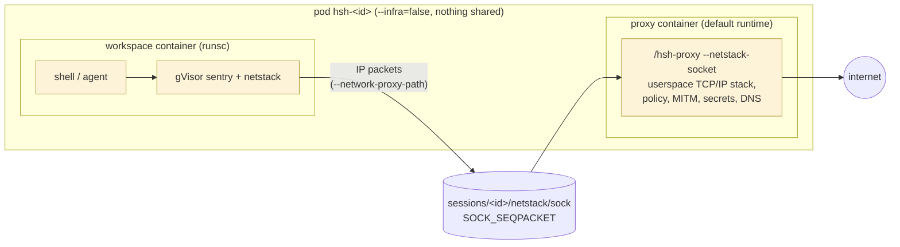

# gVisor runtime (prototype)

`hsh run --runtime gvisor` runs the workspace container under gVisor
(`runsc`) instead of the default container runtime. The workspace's
syscalls are served by gVisor's userspace kernel, and its network is
handed, as raw IP packets, to the egress proxy, which stays in its own
ordinary container. The runtime is recorded in the session
(`$XDG_STATE_HOME/hsh/sessions/<id>/runtime`) and `--resume` keeps it.

Status: prototype. It is opt-in and the default runtime is unchanged.

## Requirements

- Rootless podman with pasta. No `/dev/kvm` is needed (gVisor's default
  `systrap` platform).
- runsc. Release builds of hsh embed it (see below), so nothing else
  needs installing. `HSH_RUNSC=/path/to/runsc` overrides the embedded
  copy. A build without it (a plain `go build`) uses `runsc` from `PATH`,
  installed from https://gvisor.dev/docs/user_guide/install/#install-latest
  with its `gvisor-bin/` directory next to it.

## Embedded runsc

Release binaries are built with `-tags gvisor_embed`, which embeds
`internal/gvisor/payload.tar.gz` with `go:embed`. `internal/gvisor/payload.sh
GOARCH` produces that payload:

- It downloads the pinned gVisor release tarball for the architecture
  from `storage.googleapis.com/gvisor/releases/release/<version>/<arch>/`
  and gVisor's Apache-2.0 `LICENSE` from the matching GitHub tag. Both are
  checked against SHA-512 and SHA-256 hashes pinned in the script.
- It keeps only what rootless podman needs: `runsc` and
  `gvisor-bin/{gvisor_sentry,gvisor-sentry-prewarmer,gvisor-proc-umounter,runsc-fd-parking}`
  (runsc refuses to start without each of these sidecars). The
  containerd shim, `checkpointgofer`, and `runsc-metric-server` are
  dropped. It adds `LICENSE` and `VERSION`.
- It writes a reproducible tar.gz (sorted names, zero mtimes and owners,
  `gzip -n`), plus `payload.version` and `payload.sha256`, which are
  embedded too. The payload files are generated, not committed.

This adds about 30 MB to the binary (amd64: 21 MB → 53 MB; arm64: 47 MB).
Upgrading gVisor means changing the version and hashes in `payload.sh`,
which ships in the next hsh release through the normal `hsh update`.

On first use (`hsh run --runtime gvisor`),
`internal/gvisor` installs the payload under
`$XDG_STATE_HOME/hsh/gvisor/<first 16 hex of the payload SHA-256>/`:

- `gvisor/` is created 0700 and must be a directory owned by the user
  and not writable by others (no symlink). Each install directory has
  the same checks. Nothing goes to a shared temporary directory, where
  another user could plant a binary that podman would then run.
- The payload's SHA-256 is checked against the embedded `payload.sha256`,
  and the payload is extracted into a fresh `.extract-*` directory next to
  the target. Only regular files and directories with local relative
  names are accepted; files get the archive's owner bits only (0700 or
  0600). A `.complete` marker is written, then the directory is renamed
  into place. A concurrent extraction that loses the rename uses the
  winner's directory. A directory without `.complete` is never used.
- Later runs reuse a complete directory without rehashing the payload.
  Extraction takes about a third of a second.
- After installing, versions that are neither current nor named by any
  session's `runsc` wrapper are removed, along with `.extract-*` leftovers
  older than an hour. A running session keeps its wrapper, even across an
  hsh upgrade, so `podman exec` and `stop` keep using the runsc that
  started its sandbox. The wrapper is rewritten the next time the
  session's container starts.
- `hsh version` reports the embedded gVisor release.

## Layout



- `hsh run` writes a wrapper, `sessions/<id>/runsc`, that runs
  `runsc --ignore-cgroups --overlay2=none --network-proxy-path=<session>/netstack/sock`,
  and creates the workspace container with `podman create --runtime <wrapper>`.
  Podman records the runtime on the container, so later `start`, `attach`,
  `exec`, and `pod stop` use it without extra flags.
- The proxy container bind-mounts `sessions/<id>/netstack` and listens
  on the socket. `hsh run` removes a stale socket before starting the
  proxy and waits for the new one before starting the workspace, because
  runsc dials the socket once at sandbox start and fails if no one is
  listening. Each workspace start (including `--resume`) is a new
  connection; the proxy runs one TCP/IP stack per connection and drops
  it when the sandbox disconnects.
- runsc copies the workspace container's network namespace (its single
  pasta interface, addresses and routes) into its netstack and attaches
  that interface to the socket. All of the workspace's traffic arrives at
  the proxy; nothing reaches pasta. If the proxy is gone, the workspace
  has no network.
- The workspace container gets no extra capabilities. `/hsh-workspace
  --netstack` skips the veth, the inner network namespace, and the proxy
  environment variables. It points `/etc/resolv.conf` at `10.77.0.1`
  (any address works, since every packet goes to the proxy), installs
  the session CA, and drops capabilities as in the default runtime.
- `--overlay2=none` makes the container's root filesystem changes land in
  podman's container layer, so they survive stop and `--resume`. Without
  it runsc keeps them in a sandbox-private overlay that is discarded.
- `--ignore-cgroups` is required for rootless runsc under podman, so
  gVisor sessions have no cgroup resource limits.

## Transparent proxying

The proxy terminates the workspace's TCP connections in its own gVisor
`pkg/tcpip` stack and applies the same policy as the HTTP proxy, keyed by
hostname:

| Traffic | Host used for policy | Handling |
|---|---|---|
| TLS (first byte `0x16`) | ClientHello SNI | `connectAllowed`; secrets or OAuth → MITM with the session CA; otherwise a tunnel dialed by the SNI name, so a forged SNI cannot reach another address |
| plain HTTP (request line) | `Host` header | `plaintextAllowed`; secrets and OAuth as for proxied HTTP |
| anything else (the client sends nothing within 3 s, e.g. SSH) | name from the proxy's DNS answers for the destination IP | allowed only if that name is on the allowlist (in every mode) |
| TCP or UDP port 53 | query name | the existing DNS handler |
| other UDP, ICMP | — | dropped |

A TLS connection with no SNI falls back to the DNS-answer name, then to
the destination IP. Denied TLS connections that carry an SNI are completed
with a certificate from the session CA and answered with the usual 403
denial message, so agents see the same explanation as through the HTTP
proxy. Denials, holds, approvals, and `monitor.db` records work as for the
HTTP proxy.

In `allowlist` and `none` modes, an A query for a name that is not allowed
is answered with a placeholder address from `198.18.0.0/15` (TTL 1, and an
empty AAAA answer) instead of being refused. The client then connects,
the proxy maps the placeholder back to the name, records the denial, and
holds or denies the connection. If the name is approved, the proxy dials
it by name. A pure DNS lookup of a denied name is therefore not recorded
as a denial; only the connection attempt is.

## Reaching servers inside the session

`hsh forward`, `hsh run --forward`, `hsh ssh`, and `hsh oauth callback`
work as in the default runtime, served by a separate role, `/hsh-sshd`.
`hsh run` bind-mounts the hsh binary read-only at `/hsh-sshd` in the
workspace container, and the host commands run `podman exec -i
<pod>-ws /hsh-sshd` instead of `/hsh-workspace-inner --ssh-stdio` when
the session's runtime is gvisor.

```
hsh forward / ssh hsh-<id> / hsh oauth callback      (host)
  └─ podman exec -i <pod>-ws /hsh-sshd               (inside the gVisor sandbox)
       ├─ direct-tcpip localhost:PORT → dial 127.0.0.1 / ::1 in the sandbox
       ├─ session → /hsh-sshd --session-shell (env and cwd of PID 1)
       └─ --deliver PORT --request REQ → 127.0.0.1:PORT
```

- `/hsh-sshd` runs inside the sandbox, in the same network namespace as
  the shell, so it needs no relay, veth, or `setns`. It dials only
  `127.0.0.1` and `::1`. Any other address would leave the sandbox through
  the netstack and reach the proxy, so it is never tried. The SSH server
  (`internal/sshd`) refuses non-loopback `direct-tcpip` destinations as
  in the default runtime.
- It holds no secrets and has no route to them: the CA key, the
  resolved secrets, and the monitor database are only mounted in the
  proxy container. On start it drops every capability except
  `CAP_DAC_OVERRIDE` and sets `NO_NEW_PRIVS`, the same restrictions as
  the session's shell, before serving.
- Session shells (`ssh hsh-<id>`, `ssh hsh-<id> CMD`, `ssh -tt`) exec
  `/hsh-sshd --session-shell`, which copies the environment, shell
  (`HSH_SHELL`), and working directory of PID 1 (the session's shell or
  agent, which `/hsh-workspace --netstack` execs in place), makes fd 0
  the controlling terminal for pty sessions, and execs the shell.
- Listeners for `hsh forward --list` and auto-forwarding come from the
  sandbox's `/proc/net/tcp{,6}`.

## Not supported yet

- `tty` reports `ttyname error` inside the sandbox; the terminal itself
  (size, job control, detach/attach) works.

## Tests

`test/gvisor.sh` runs end-to-end checks and skips when runsc is missing:
transparent forwarding with secret injection, the 403 denial message over
intercepted TLS, IP literals and ICMP refused, `monitor.db` records,
resume after stop, no egress after the proxy is killed, and `hsh forward`,
`ssh hsh-<id>`, and `hsh oauth callback` through `/hsh-sshd`.
