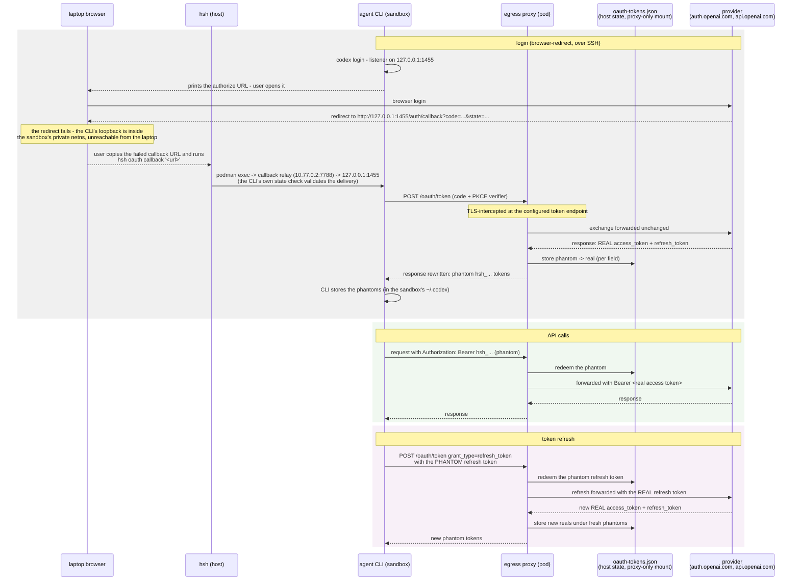

# Sandboxed OAuth logins (design doc)

Let a coding agent run its OAuth login flow **inside** the hsh sandbox
while the sandbox only ever receives **phantom tokens**. The real token
material never enters the workspace; later API calls still authenticate
because the egress proxy resolves phantoms back to real tokens — only for
declared API hosts.

This design is modeled on nono's *Sandboxed OAuth Logins*:
https://nono.sh/docs/cli/features/sandboxed-oauth-logins — phantom
tokens, an out-of-sandbox capture store, endpoint-scoped resolution, and
a fail-closed capture path. The sections below adapt that model to hsh's
existing pieces (the egress proxy, TLS interception, the allowlist, the
secret store from plans/0009-secret-store.md, and `--resume`).

```
OAuth provider ──► hsh proxy ──► sandboxed agent
real tokens        stores real    sees hsh_<64hex> phantoms
                   returns phantom
```

## The problem

Some agents do not use static API keys: they run an OAuth login flow
(`login`, `auth login`, or a device-code flow), receive access/refresh
tokens, and persist them for later API calls. That is a hard sandboxing
problem:

- the agent must be allowed to run the login flow (network access to the
  provider's auth endpoints),
- the real token response must **not** become readable by the sandboxed
  agent,
- later API calls must still authenticate.

hsh already solves the static-key version of this (proxy-side secret
injection, `secrets.<NAME>`). OAuth logins need the dynamic version:
the credential is minted *during* the session, by the client, through the
proxy.

## What the sandbox sees

Values shaped like credentials, but not credentials:

```
access_token  = hsh_<64 hex chars>
refresh_token = hsh_<64 hex chars>
id_token      = eyJ...<synthetic JWT-shaped phantom>...
```

- **Opaque phantoms** (`hsh_` + 64 hex) for bearer/refresh tokens.
- **JWT-shaped phantoms** for fields the client parses locally as a JWT
  (typically `id_token`): a synthetic JWT whose payload contains no
  provider-specific secrets. Never mark a field `jwt` if the client
  will later resend the whole value as `Authorization: Bearer ...` — the
  synthetic value is not provider-valid.
- **Prefix templates** (phase 2) for clients that classify credentials by
  sniffing a literal prefix (e.g. `sk-ant-oat01-…`): the phantom follows
  that shape and the template is stripped on egress before the real
  token is substituted.

A phantom is useless outside the proxy: it resolves only when it comes
back through a declared API host route. The agent can store and reuse
phantoms (its `auth.json`, keychain entry, …) but cannot redeem one
directly against the provider.

## How it maps onto hsh

| nono concept | hsh equivalent |
|---|---|
| profile (`~/.config/nono/profiles/…`) | `config.hsh` — a new top-level `oauth` section |
| nono proxy (TLS intercept + routes) | the existing `hsh proxy`: TLS interception, allowlist, CONNECT handling — capture/resolution hooks into the intercept path |
| nono OAuth capture store | the secret store from plans/0009-secret-store.md (sqlite), extended with a phantom-mapping table |
| credential routes / `api_hosts` | the provider's `apiHosts` (must also be allowlisted) |
| per-session trust bundle + `ca_env_vars` | the existing MITM CA installed in the workspace; per-client CA env vars are a phase-2 addition |
| helpers (`status`/`login`/`logout`) | `hsh oauth status` / `hsh oauth logout` (host-side, shape only) |
| session persistence | `--resume` keeps the workspace container (where the client persists phantoms); the host-side store keeps the mapping across launches |

## Flow

The whole lifecycle — login (browser-redirect, over SSH), an API call,
and a token refresh — with real tokens crossing into the sandbox
**never**; the sandbox holds phantom tokens (`hsh_…`) that only this
session's proxy can redeem:



The proxy holds the real tokens — access and refresh alike — in the
host-side store (`$XDG_STATE_HOME/hsh/oauth-tokens.json`), written and
read by the proxy container only; the workspace never sees the file.
That is the point of the refresh design: refresh tokens are
long-lived, so they stay on the host, and the sandbox only ever holds
short-lived-looking phantoms that are redeemable solely at this
session's proxy.

## Design

### Configuration

A new top-level `oauth` section in `config.hsh` (naming follows the
existing `secrets` section: `hosts`, `header`, `prefix`):

```json
"oauth": {
  "providers": {
    "MISTRAL": {
      "tokenEndpoints": [
        {
          "host": "auth.mistral.ai",
          "path": "/oauth/token",
          "responseFields": [
            {"path": "access_token", "kind": "opaque"},
            {"path": "refresh_token", "kind": "opaque"},
            {"path": "id_token", "kind": "jwt"}
          ],
          "requestBody": "form",
          "nonceFields": ["refresh_token"]
        }
      ],
      "apiHosts": ["api.mistral.ai"],
      "header": "Authorization",
      "prefix": "Bearer "
    }
  }
}
```

- `tokenEndpoints`: HTTPS host + exact path (query string ignored).
  Device-code flows often use two endpoints (poll + exchange) — list
  each. `responseFields` declares which JSON response fields carry real
  token material (`opaque` or `jwt`). `requestBody` (`auto`/`json`/`form`)
  controls how outgoing token requests are parsed; `nonceFields` are the
  request fields to scan for phantoms before forwarding upstream (dotted
  paths for JSON, top-level names for form). A capture-only endpoint
  leaves `nonceFields` empty.
- `apiHosts`: where phantoms may be resolved. These hosts must also be in
  `network.allow`.
- `header`/`prefix`: where the resolved real token is injected on API
  requests (defaults `Authorization` / `Bearer `), same semantics as
  `secrets.<NAME>.header`/`prefix`. Non-Bearer APIs override them (e.g.
  Vault: header `X-Vault-Token`, prefix ``).
- Optional `endpointPolicy` (phase 2): per-provider method+path
  allowlist for API calls (e.g. only `POST /v1/messages`).

### Capture (login)

The proxy intercepts TLS for capture hosts (they join the intercept set
alongside secret hosts). When a response from a configured
`tokenEndpoints` host+path arrives:

1. Parse the JSON body; replace each declared `responseFields` value with
   a fresh phantom; store `phantom → (provider, field, real value)` in the
   capture store.
2. Forward the rewritten body to the workspace. The client persists
   phantoms like any credential.

**Fail closed**: for responses from configured capture hosts on
*unmatched* paths, or error responses, the proxy scans for common OAuth
token field names (`access_token`, `refresh_token`, `id_token`,
`accessToken`, …). If found and not safely rewritable, the response is
blocked (502) rather than streamed back — real token material must never
reach the sandbox by accident. This is a backstop, not discovery: use the
proxy's debug log (`rewrote OAuth token response fields to phantoms
provider=… fields=N`) to find the right endpoints.

### Resolution (API calls)

When a request to an `apiHosts` host carries a phantom in the configured
header (`Authorization: Bearer hsh_…` by default):

1. Look the phantom up in the capture store.
2. If it maps to this provider, replace it with the real token and
   forward upstream.
3. If the phantom is unknown, or the host is not an API host for that
   provider, forward the request **without** resolving (the phantom is an
   opaque string to the provider — authentication fails upstream, which
   is the correct outcome).

Refresh flows work the same way in both directions: the client sends the
phantom `refresh_token` in the token request body (parsed per
`requestBody`, scanned at `nonceFields`); the proxy substitutes the real
refresh token upstream; the response's new real tokens are rewritten to
new phantoms and the store is updated.

### The capture store

- Lives **outside the sandbox**, in the sqlite store from
  plans/0009-secret-store.md. Proposed: the same database, a new
  `oauth_phantoms` table (alternative: a separate `oauth.db` in the state
  dir — see open questions):

```sql
CREATE TABLE IF NOT EXISTS oauth_phantoms (
    phantom    TEXT PRIMARY KEY,   -- hsh_<64hex>
    provider   TEXT NOT NULL,
    field      TEXT NOT NULL,      -- access_token / refresh_token / id_token
    value      TEXT NOT NULL,      -- the real token material
    created_at TEXT NOT NULL,
    used_at    TEXT
);
```

- Owner-only permissions (0700 directory / 0600 file), plaintext at rest
  under the user account — the same trust level as `~/.netrc` and as
  nono's capture store.
- Retention: entries expire after 90 days; the store is capped at 4096
  phantoms (nono's numbers — adopt or tune).
- Never mounted into the workspace. The proxy container needs it, so it
  must be reachable from the proxy — see open questions for the location
  trade-off (the state dir is already bind-mounted into the proxy).

### Lifecycle

- **Login** happens inside the sandbox: the agent runs its login command;
  the provider's auth endpoints are allowlisted; the proxy rewrites the
  token response to phantoms. Device-code flows (the agent prints a code
  or URL, the user completes it in a host browser) work with no extra
  plumbing.
- **Browser-redirect flows** (the provider redirects the *host* browser
  to a loopback callback inside the sandbox): the sandbox's loopback is
  not reachable from the host, so the bridge is the `hsh oauth
  callback` command — over SSH the browser lands on the failed
  loopback URL, and replaying it delivers the callback into the waiting
  session:

  ```
  laptop$ ssh server
  server$ hsh run ghcr.io/philips/hsh-codex
  sandbox$ codex login                      # prints the authorize URL
  laptop-browser: open the URL, complete the login — the redirect to
              http://127.0.0.1:1455/auth/callback?code=... fails, but
              the URL is visible in the address bar
  server$ hsh oauth callback 'http://127.0.0.1:1455/auth/callback?code=...&state=...'
  # delivered into the session: the CLI completes the exchange through
  # the egress proxy, which captures the real tokens and returns phantoms
  ```

  Run it from the workspace directory (the session is resolved the same
  way `hsh run --resume` resolves it; `--session` picks explicitly) and
  promptly — authorization codes are short-lived. The pasted URL's
  `state` makes mis-delivery fail safe: a wrong session's CLI rejects
  it. Non-loopback URLs are refused. The reverse path is a small
  per-session callback relay on the workspace veth (`10.77.0.2:7788`)
  that dials the session's loopback on demand; the workspace-inner
  starts it automatically.
- **Persistence**: with `--resume`, the workspace container keeps the
  client's stored phantoms across launches, and the host-side store keeps
  the phantom→real mapping — a logged-in session survives `hsh` restarts.
- **Helpers** (host-side, never print values):
  - `hsh oauth status` — providers, phantom counts, created/used times,
    and which are expired. Shape only.
  - `hsh oauth logout PROVIDER` — deletes the provider's store entries.
    The client's stored phantoms remain but stop resolving (its next
    refresh fails and it re-logs-in).

## Security model

Three boundaries (mirroring nono):

1. **Real token responses are rewritten before the sandbox sees them.**
   The workspace only ever receives phantoms.
2. **Phantoms resolve only through declared proxy routes.** A phantom
   sent anywhere else — another host, a non-API path, a third party —
   is an opaque random string. A successful login does not give the agent
   a transferable bearer token.
3. **Capture fails closed.** When the proxy cannot safely rewrite a
   token-bearing response, it blocks it instead of streaming real
   material back.

Not protected (same as the rest of hsh — see the README: use a VM for
persistent attackers or hostile providers):

- the capture store at rest (plaintext, owner-only; same as `~/.netrc`),
- a compromised host or proxy process (memory/ptrace),
- the agent *using* its login through the proxy (that is the point) —
  including calling any allowlisted API host with the resolved credential,
- phantoms leaked to third parties (useless there, but they do reveal
  that a login exists).

## Implementation sketch

- `internal/oauth` (new): phantom generation (`hsh_` + 32 random bytes,
  hex), JWT-shaped phantom synthesis, response rewriting (declared
  fields → phantoms), request parsing (form/JSON + nonce fields),
  phantom detection in headers, the fail-closed field sniffing.
- `internal/secretstore`: the `oauth_phantoms` table + CRUD (store,
  resolve, delete-by-provider, retention sweep, cap enforcement).
- `internal/config`: parse/validate the `oauth` section; unknown
  provider references or malformed endpoints fail at load.
- `internal/proxy`: extend the intercept decision (capture hosts and API
  hosts are intercepted); in the intercept path, rewrite capture
  responses, resolve API requests, apply the fail-closed backstop; debug
  log lines for capture/resolve events (never log bodies or values).
- `internal/cli/run.go`: hand the proxy the store path (mounted like the
  denial DB) and the oauth config (read from the mounted config).
- `internal/cli/oauth.go`: `hsh oauth status` / `hsh oauth logout`.
- `main.go`: register `oauth`.
- Docs: `docs/config.md` (the `oauth` section), `docs/architecture.md`
  (a "Sandboxed OAuth logins" section next to "Secret injection").

## Phases

1. **Phase 1**: one provider, opaque phantoms, capture + resolution +
   fail-closed backstop, device-code-friendly flows, `hsh oauth status`.
2. **Phase 2**: JWT-shaped phantoms (`id_token`), prefix templates,
   `endpointPolicy`, per-client CA env vars, browser-redirect callback
   bridge, credential-store shape verification (check the client's
   persisted auth file contains phantom-shaped values — never print
   values).

## Verification

1. Unit tests (`internal/oauth`, `internal/secretstore`): phantom format;
   response rewriting replaces declared fields and stores the mapping;
   request resolution for form and JSON nonce fields; unknown phantoms
   and non-API hosts are not resolved; fail-closed blocks unmatched
   capture-host responses containing token fields; JWT phantoms are
   well-formed synthetic JWTs; retention sweep and cap enforcement.
2. Functional test with a dummy OAuth provider (extend `test/` with a
   tiny server: `POST /oauth/token` returns real tokens, `GET /api`
   requires `Authorization: Bearer <real>`):
   - the sandbox client "logs in" → the response body contains `hsh_`
     phantoms and **not** the real tokens (grep the session output),
   - the client then calls the API with the phantom → the dummy provider
     asserts it received the **real** token and returns data,
   - a phantom sent to a non-API host is not resolved,
   - the refresh flow: phantom `refresh_token` → new real tokens upstream
     → new phantoms in the response,
   - `hsh oauth status` lists the provider without values; after
     `hsh oauth logout`, API calls with the old phantom fail upstream.
3. `CGO_ENABLED=0 go build`, `go vet`, full functional test pass.

## Open questions

- **Store location**: the plan-0009 secret store lives in
  `$XDG_CONFIG_HOME/hsh/secrets.db` (config home), but the proxy needs
  the phantom mapping and only the *state* dir is mounted into it.
  Options: (a) put `oauth_phantoms` in a state-dir DB
  (`$XDG_STATE_HOME/hsh/oauth.db`, mounted like the denial DB), (b) same
  table in the config-home store plus an extra bind mount. Proposed: (a).
- **`endpointPolicy`** (method+path allowlist per provider): phase 2 —
  include?
- **Retention/cap numbers**: adopt nono's 90 days / 4096 phantoms?
- **`hsh oauth logout` semantics**: delete store entries only (the
  client re-logs-in on next use), or also try to run the client's logout
  command inside the sandbox?
