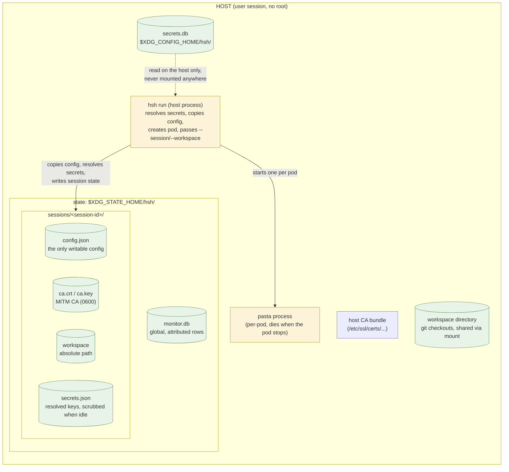
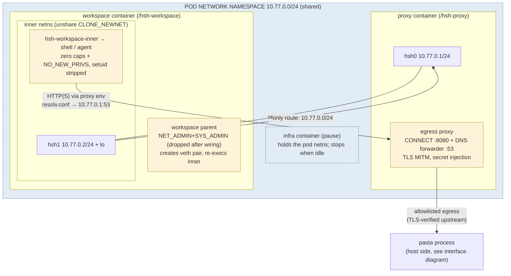
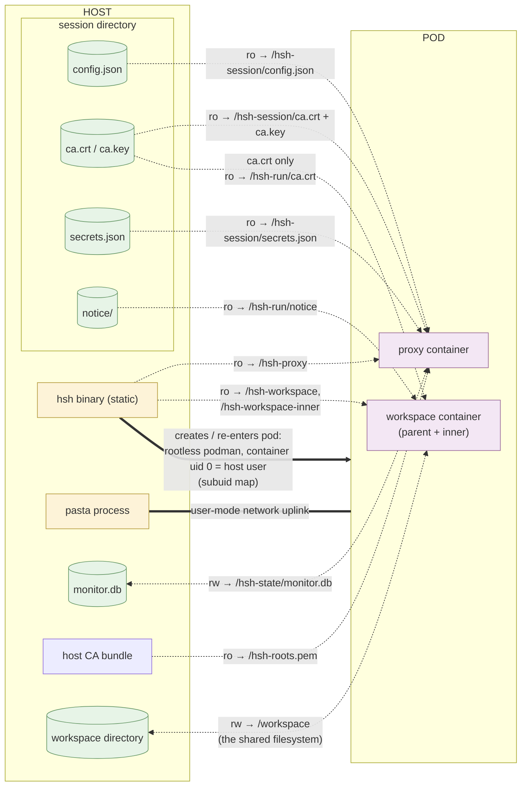

# hsh architecture

hsh runs an interactive shell inside a rootless podman sandbox with
controlled egress. It is a single static Go binary that plays three roles:

| Mode | Runs | Purpose |
|---|---|---|
| `hsh run` | on the host | loads config, creates the pod and containers, attaches to the workspace |
| `/hsh-proxy` | proxy container, inside the pod | egress proxy: network policy (https/allowlist/none), TLS interception, secret injection |
| `/hsh-workspace` / `/hsh-workspace-inner` | workspace container, inside the pod | network isolation setup, then the user's shell |
| `/hsh-sshd` | workspace container, gVisor sessions only | SSH server for `hsh forward`, `hsh ssh`, and `hsh oauth callback` inside the sandbox; see [gVisor runtime](gvisor.md) |

Host-side subcommands manage state around the sandbox: `hsh secret`
(the secret store below), `hsh proxy` (denial review) and `hsh monitor`
(the review TUI), and `hsh ls`/`hsh rm` (sandbox lifecycle).
`hsh version` prints the release tag, git commit, and platform. The tag
is stamped by the release workflow with
`-ldflags "-X hsh/internal/version.Tag=$GITHUB_REF_NAME"`; local builds
report `dev` plus the VCS commit (`-dirty` with uncommitted changes).

The same binary is bind-mounted read-only under role-named paths in the
containers (`/hsh-proxy` in the proxy, `/hsh-workspace` and
`/hsh-workspace-inner` in the workspace) and used as the container
entrypoints; the role is dispatched on argv[0], so the container plumbing
is not part of the user-facing command set. The `proxy`, `workspace`, and
`workspace-inner` subcommand names remain as aliases (and keep
sessions created before the rename resumable with `hsh resume`).

## Pod layout

`hsh run` creates one podman pod (a session) with two containers. The
layout is shown in three diagrams: the host side that `hsh run` sets
up, the pod side it creates, and the interface between them (every bind
mount, the pasta uplink, and the user-namespace mapping).

### Host side

What `hsh run` touches before and during a session — all of it inside the
invoking user's own directories, no root required:



### Pod side

What runs inside the pod once it exists — two containers, two network
namespaces, and the only paths between them:



### Host–pod interface

Everything that crosses the sandbox boundary: the mounts the pod is
assembled from, the pasta uplink, and the user-namespace mapping:



Reading notes:

- **Two network namespaces**: everything of the pod shares one netns
  (infra, proxy, workspace parent); the shell runs one netns deeper —
  `/hsh-workspace-inner` calls `unshare(CLONE_NEWNET)` and the parent
  moves the `hsh1` veth end into it. The only route out of the inner
  netns is the veth to the proxy; direct egress fails at the TCP layer.
- **User namespace**: rootless podman — container uid 0 maps to the
  invoking host user (subuid mapping). The parent process briefly holds
  NET_ADMIN/SYS_ADMIN to wire the veth pair, then drops all
  capabilities; the inner process keeps only CAP_DAC_OVERRIDE (overlayfs
  needs it to create new entries — whiteouts and directory copy-up — in
  image-layer directories; without it `dnf`/`rpm` unpacks fail with
  "cpio: symlink failed - Permission denied"), sets NO_NEW_PRIVS, and
  setuid binaries are stripped from the workspace.
- **Filesystem**: dashed edges are bind mounts, thick arrows are pod
  lifecycle control, and `===` is the pasta network uplink (see the
  interface diagram for the full mount set). The session directory is
  mounted read-only into the proxy only (config copy, resolved secrets,
  CA); the workspace sees only the CA certificate and the network notice
  directory. `secrets.json` never enters the workspace.
- Pods do not share PID namespaces, so the workspace cannot see or
  signal the proxy's processes.
- **Idle**: when the shell exits the whole pod is stopped (infra and
  proxy included, killing the pod's pasta process) and `secrets.json`
  is unlinked from the session directory.

## Network isolation

This section describes the default runtime. With `hsh run --runtime
gvisor` the workspace runs under gVisor and its packets go straight to
the proxy over a Unix socket instead; see [gVisor runtime](gvisor.md).

The workspace container starts in the pod's network namespace with
`NET_ADMIN` and `SYS_ADMIN` capabilities. Its entrypoint
(`/hsh-workspace`):

1. creates a veth pair (`hsh0`/`hsh1`) in the pod network namespace and
   configures `hsh0` with `10.77.0.1/24`
2. re-executes `/hsh-workspace-inner`, which calls
   `unshare(CLONE_NEWNET)` to move into a fresh, empty network namespace
3. moves `hsh1` into the child's namespace (via netlink, by a file
   descriptor for `/proc/<child>/ns/net`; gVisor rejects the by-PID form)
4. drops all of its own capabilities
5. signals the child, which configures `hsh1` with `10.77.0.2/24` and brings
   up loopback

The child namespace has exactly one route: `10.77.0.0/24 dev hsh1`. There is
no default route, so the workspace cannot reach the internet, the host, or
any other network directly. Its `/etc/resolv.conf` points at the proxy
(`10.77.0.1`), where a DNS forwarder runs (see below), so names resolve only
when allowlisted — but resolved names still cannot be reached directly.

The child then:

- installs the proxy CA into `/etc/ssl/certs/ca-certificates.crt`
- creates the home directory, strips setuid/setgid bits from the container
  filesystem (excluding the workspace mount)
- applies the network notice: if `/hsh-run/notice/network-policy.md` exists,
  it replaces `{network_policy}` in the launch and headless argv with that path
  and upserts the managed block into each `agent.context_files` entry;
  otherwise it drops the placeholder argument (and the flag before it) and
  removes any managed block. Doing this at every start keeps a reused
  container (resume) consistent with the notice file
- drops all capabilities except CAP_DAC_OVERRIDE and sets `PR_SET_NO_NEW_PRIVS`
- `chdir`s into the workspace and `exec`s the configured shell. When the
  config's `agent.launch` is set and the shell is bash, the shell is
  exec'd with `--rcfile` pointing at a generated rcfile (job control
  enabled via `set -m`, standard rcfiles sourced, then the launch argv
  run as a foreground job): interactive sessions auto-launch the agent
  harness, Ctrl-Z suspends it into the shell, and non-interactive
  sessions skip it because bash only reads the rcfile when interactive

The shell runs as container uid 0, which rootless podman maps to the invoking
host user, so files written to mounted directories are owned by the host
user. With only CAP_DAC_OVERRIDE effective and `NO_NEW_PRIVS` it cannot
modify routes, create namespaces, or regain privileges through setuid
binaries; CAP_DAC_OVERRIDE only bypasses file-permission checks inside the
sandbox's own filesystem (the kernel requires it for overlayfs copy-up when
creating files in image-layer directories — package installation needs it,
an ordinary `podman run --cap-drop=ALL` fails the same way).

The workspace parent process (container PID 1) also drops its capabilities
after moving the veth, so it cannot be ptraced for privileges either.

## Egress proxy

The proxy listens on `10.77.0.1:8080` — the only address the workspace can
reach. The workspace shell gets `http_proxy`/`https_proxy`/`all_proxy`
(plus uppercase variants) pointing at it, and `no_proxy` for loopback and
the veth addresses.

Every request is checked against `network.allow`:

- **Denied**: the proxy records the host in the monitor database and answers
  `403 Forbidden`, as other agent sandboxes do. For `CONNECT` this surfaces
  in curl as `CONNECT tunnel failed, response 403`. The body is written for
  an agent: the block is on purpose and not an outage, the user has been
  notified (`hsh monitor`), and the agent should tell the user which host it
  needs and why rather than try other tools, mirrors, proxies, or DNS tricks.
  Most clients never show the body for a denied `CONNECT`, so the same
  instructions also reach the agent's system prompt through the
  [network notice](config.md#network-notice). Optionally the proxy holds
  the request first (below).
- **Allowed, no secret configured for the host**: the proxy tunnels the
  connection (`CONNECT` → `200 Connection Established`, then a raw TCP
  splice). TLS is end-to-end between the workspace and the upstream; any
  protocol works.
- **Allowed, secret configured for the host**: the proxy intercepts.
  `CONNECT` is answered with `200`, the proxy terminates the client's TLS
  with a per-host certificate signed by the run's CA, reads the HTTP
  request, injects the configured headers, and forwards the request
  upstream over a fresh verified TLS connection. Responses stream back.

Plain-HTTP proxy requests (absolute URIs) are forwarded the same way, with
injection applied when the host matches a secret.

### Holding denied requests

An agent that is refused can start working around the refusal, which costs
tokens. The 403 body and the network notice therefore tell it to stop and
ask. hsh can also **hold** a request the policy would deny until the user decides. Holding
is **off by default** (a held request looks like a hung network, which is
often a worse experience than a fast failure with instructions) and is
enabled per session with `network.approval_wait` (for example `"30s"`; at most
`5m`; `off`/`0s` disables):

- The denial is recorded first, so the host shows up in `hsh monitor` and
  the inline status line at once, and `monitor.db`'s `holding` column counts
  the requests currently held for that host (the monitor lists held hosts
  first with `HELD xN`; the status line says `(N held)`; the proxy zeroes
  its session's counts when it starts).
- The proxy then polls every 250 ms. It lets the request through as soon
  as the host is allowed (an approval rewrites the session config and the
  proxy's one-second reload picks it up), fails it with the normal 403 as
  soon as the user *ignores* the host (the row is marked ignored; hosts
  already ignored are not held at all), and otherwise fails it when the wait
  runs out, when holding is switched off by a reload, when nobody is watching
  any more, or when the client goes away. At most 64 requests are held at
  once; beyond that requests are denied immediately.
- Applies to `CONNECT` and plain-HTTP requests before they are hijacked or
  forwarded. DNS queries are never held. `none` mode never holds, because nothing can be approved there; `https`
  mode only holds what it denies (plaintext and non-443).
- **Only while someone can approve.** The proxy holds only if the file
  `attended` in the session directory (mounted read-only into the proxy as
  `/hsh-session/attended`; `--attended` on `hsh-proxy`) was modified within
  the last 20 seconds. `hsh run` keeps it fresh while an inline-review relay
  is attached, and `hsh monitor` (unscoped, or for its `--session`/
  `--workspace` filter) and `hsh proxy allow --watch` do the same for the
  sessions they cover. Without it requests are denied at once. A proxy
  started without `--attended` never holds.
- Holding does not widen policy: allow decisions still come only from the
  allowlist in the session config, and a hold ends in the same denial as
  without holding.
- Per session: `hsh proxy hold [--session ID] [on|off|default|DURATION]`
  rewrites `network.approval_wait` in the session config (`on` is 30 s), and
  `w` in `hsh monitor` (and the inline review screen, which is the same
  model) toggles it for the selected row's session; the title shows
  `holding: 30s` or `holding: off`.

### DNS

The workspace's `/etc/resolv.conf` points at the proxy (`10.77.0.1`), where
a DNS forwarder (UDP and TCP 53) runs alongside the HTTP proxy. Query names
are matched against `network.allow` with the same rules as HTTP: allowed
names are forwarded to the pod's upstream resolvers (from the proxy
container's `/etc/resolv.conf`), everything else gets `REFUSED`.

Because the workspace has no route beyond the veth, resolved names still
cannot be reached directly — local DNS feeds tools that resolve before
connecting through the proxy, and debugging (`getent`, `nslookup`). The
policy matters: an unrestricted resolver would let the workspace exfiltrate
data via DNS tunneling without ever opening a TCP connection the proxy
could check.

A refused lookup is only logged (`dns: refused <name>`): it is not recorded
in the `denied` table, not held, and never reaches `hsh monitor`. A lookup
is not "the agent tried to reach X" — resolvers and tools issue speculative
queries, and the workspace cannot reach a resolved name directly anyway —
so review items come only from connection attempts (a refused CONNECT,
plaintext request, or transparent connection). Approving a host makes both
the lookup and the connection work.

### Monitor database

Everything the monitor shows is recorded in one SQLite database
(modernc.org/sqlite — pure Go, so the `CGO_ENABLED=0` static build is
unaffected) at `$XDG_STATE_HOME/hsh/monitor.db` (default
`~/.local/state/hsh/monitor.db`, override with `hsh run --monitor-db PATH`).
Today it holds the `denied` table below; the file is named for `hsh monitor`
so later monitor state can live beside it. The database is opened in WAL
mode with a busy timeout, so the proxy (writer) and the CLI (reader) can use
it concurrently, including across simultaneous sessions.

The schema version is `PRAGMA user_version`. `internal/dbschema` checks it
inside one `BEGIN IMMEDIATE` transaction on every open: a file with version 0
(new, or an existing file created without a version) gets the
`CREATE TABLE IF NOT EXISTS` schema and the current version, so several
proxies and a monitor starting at once agree on one schema; a file with a newer
version is refused (`monitor.db has schema version N, newer than this hsh
reads (version V); update hsh`) and an older one too (`remove PATH`); there are
no migrations. `session.db` and `secrets.db` use the same check. A proxy
container started from an older hsh than the database therefore fails to
start with that message instead of writing rows it does not understand.

The database is global: rows from every session and workspace land in one
review queue, attributed per row — `hsh run` passes the session id and the
workspace path to the proxy container (`--session`/`--workspace` on
`hsh-proxy`), and both are stored on each row of the single `denied` table
(keyed by host + session). `hsh proxy denied` and `hsh monitor` filter
on `--session`/`--workspace`; `hsh proxy allow` takes a `--session` and
writes that session's config copy, so one session's approvals never
leak into another session's policy.

```sql
CREATE TABLE IF NOT EXISTS denied (
    host       TEXT NOT NULL,
    session    TEXT NOT NULL DEFAULT '',
    workspace  TEXT NOT NULL DEFAULT '',
    target     TEXT NOT NULL,   -- host:port as requested
    count      INTEGER NOT NULL,
    first_seen TEXT NOT NULL,   -- RFC 3339, UTC
    last_seen  TEXT NOT NULL,
    allowed    INTEGER NOT NULL DEFAULT 0,
    allowed_at TEXT,
    ignored    INTEGER NOT NULL DEFAULT 0,
    holding    INTEGER NOT NULL DEFAULT 0,  -- requests currently held
    PRIMARY KEY (host, session)
);
```

Recording is an upsert on host + session (count incremented,
`last_seen` bumped); `allowed` marks rows already handled. Only
connection denials (a refused CONNECT, plaintext request, or transparent
connection) are recorded; refused DNS lookups are not — see the DNS section
above. The state directory is bind-mounted
read-write into the proxy container only — the workspace never sees it,
so the agent cannot erase or forge its own denial record. Database
errors are logged and never change the response: a denial is a denial
with or without the log.

The host-side commands work with the database:

```
hsh proxy denied [--session ID] [--workspace PATH] [--watch]   list the queue
hsh proxy allow --all --session ID [--watch]                   allow every pending host
hsh proxy allow --session ID https://example.com [--watch]    allow one host
hsh monitor [--session ID] [--workspace PATH] [--all]         command palette (TUI)
```

`proxy denied` prints pending rows (`allowed = 0`) as a table (session
id, workspace, URL, count, last seen, sorted by count); a
`--session`/`--workspace` filter narrows the output to bare URLs;
`--watch` continuously prints new denials. `proxy allow` writes hosts
into the session's config copy (`network.allow`), prints
`added https://<host>` (or `already allowed`), and marks the rows
allowed so they leave the queue — trust on first use: the first attempt
is denied and recorded, review allows it, running proxies hot-reload
the config within ~1s. `--all` approves everything pending for the
session; a URL argument allows a single host (the URL is normalized to
its hostname). `--watch` keeps approving new denials as they appear.

`monitor` is the interactive counterpart (bubbletea/bubbles TUI,
requires a terminal, runs full-screen in the alternate screen buffer):
a multi-select table of pending denials — SESSION, WORKSPACE, URL,
COUNT, LAST SEEN, in that order — most recently requested first,
refreshed live every 2s. `--session`/`--workspace` scope the view (the
title shows the active scope) and the columns fill the terminal
width. Keys: `space` select the cursor row, `a`/`n` select/clear all,
`enter` approve the selected hosts (added to the session's
`network.allow`, marked allowed), `i` ignore them (marked handled
without allowing), `t` toggle a view of ignored rows (marked
"(ignored)", not selectable), `/` filter the table live while typing
(matches session ids, workspaces, and hosts; `tab` completes the input
against sessions, workspaces, and hostnames — unique matches fill in,
ambiguous ones extend to the common prefix and list the candidates in
the status line; `enter` keeps the filter, `esc` clears it), `r`
refresh, `↑/↓/j/k` navigate, `q` quit. Keys: `space` select,
`a`/`n` select/clear all (ignoring any active filter), `/` filter,
`enter` approve the selected hosts (added to the session's
`network.allow`, marked allowed), `i` ignore them (marked handled
without allowing: they leave the review list permanently), `t` toggle a
view of ignored hosts (dimmed, non-selectable), `r` refresh, `?` help,
`q`/`esc`/`ctrl+c` quit.

## Secret injection

Secrets are declared in the config as `secrets.<NAME>` with:

- `from`: a reference URL — `env://VAR` (host environment variable,
  also written as a bare `VAR`), or `hsh://NAME` (the hsh secret store;
  see below). Unknown schemes fail at config load.
- `hosts`: hosts the secret may be injected for
- `header` (optional): header name; defaults to the secret name with `_`
  replaced by `-` (e.g. `API_KEY` → `Api-Key`)
- `prefix` (optional): prepended verbatim to the value (e.g. `"Bearer "`)

The flow keeps the secret out of the workspace entirely:

1. `hsh run` resolves the references (`os.Getenv` for `env://`, the
   secret store for `hsh://`) and writes the values
   to `secrets.json` in a temporary directory (mode 0600)
2. the temporary directory is bind-mounted read-only into the **proxy
   container only** — the workspace container never sees it
3. the proxy injects `header: prefix+value` into requests whose host matches
   `hosts`, replacing any value the workspace sent

The workspace cannot read the proxy container's files (different container,
private PID namespace, root-owned 0600 file), cannot redirect an injected
request to another host (the proxy dials the `CONNECT` target itself), and
the proxy logs header names but never values.

### The hsh secret store

`hsh secret add/rm/ls` manage a first-party store so users stop
hand-editing configs or exporting keys into their shell environment:

- a SQLite database at `$XDG_CONFIG_HOME/hsh/secrets.db` (directory
  `0700`, file `0600`, plaintext values — the same trust level as
  `~/.netrc`; a first-use note warns about it)
- `secret add NAME` prompts with echo disabled (or `--value-stdin` for
  scripting); there is deliberately no `--value` flag, since values on
  the command line leak into shell history and the process list
- `secret add --host/--header/--prefix` also writes the
  `secrets.<NAME>` config entry with `from: "hsh://NAME"`
  (RawMessage-preserving rewrite, like `hsh proxy allow`)
- `secret rm` warns when the config still references the entry but never
  edits the config; `secret ls` prints names and timestamps, never values
- only the host-side `hsh run` process and the `secret` subcommands touch
  the store; the store lives on the host and is never mounted into the
  sandbox. A missing entry behaves exactly like an unset environment
  variable: a warning, and the secret is skipped.

The scheme-based `from` makes further backends (OS keyrings, `dotenv`,
password managers) a scheme-registration addition without changing the
config format or the proxy; the model is nono.sh's credential injection
(https://nono.sh/docs/cli/features/credential-injection).

## TLS interception

`hsh run` generates a fresh ECDSA P-256 CA per session; it is persisted in
the session state (`$XDG_STATE_HOME/hsh/sessions/<session-id>/ca.key`,
mode 0600) so the CA the workspace trusts stays stable across re-entries,
and it is never written anywhere else. The CA certificate is bind-mounted into the
workspace (which appends it to the system trust bundle and exports
`SSL_CERT_FILE`, `GIT_SSL_CAINFO`, `NODE_EXTRA_CA_CERTS`,
`CURL_CA_BUNDLE`, `REQUESTS_CA_BUNDLE`); the CA private key is mounted
into the proxy container only. The proxy signs per-host leaf certificates
on demand (cached per host).

Upstream TLS is verified against the host's CA bundle (bind-mounted into the
proxy container, falling back to the image's bundle).

Interception is required for secret hosts and is a deliberate design
decision, not a gap: injecting a header into an HTTPS request means
terminating TLS, and the secret must never enter the workspace. Hosts
without secrets are tunneled end-to-end instead. The known costs are that
the proxy can read and modify all traffic to intercepted hosts, non-HTTP
protocols to those hosts break, and clients that use their own CA bundle
need a per-client CA variable (see docs/sandboxed-oauth.md).

## Configuration hot reload

The proxy polls the config file and the resolved-secrets file once per
second and swaps its in-memory state when either changes. `hsh run`
likewise watches the config file and rewrites `secrets.json` when it
changes, so `network.allow` and secret values/hosts update without
restarting the sandbox. Both files are reached through **directory**
bind mounts so that replacing the file (editors and `sed -i` rename files)
is picked up.

Mounts, image, and shell changes require a restart.

A reload that fails (invalid JSON, a field hsh does not know, a `version`
this binary does not read) is logged as `configuration reload failed` and the
proxy keeps its previous in-memory policy, so a proxy older than its config
(a detached session that outlived an `hsh update`) keeps enforcing the last
config it understood. `hsh run` and the proxy fail at startup on an unreadable
config instead. See [config versions](config.md#config-versions).

## Reaching servers inside the session

This section describes the default runtime. gVisor sessions serve the
same commands from `/hsh-sshd` inside the sandbox; see
[gVisor runtime](gvisor.md#reaching-servers-inside-the-session).

A server the agent starts on its loopback (`localhost:8000`) lives in the
inner network namespace, which nothing outside can reach directly. Inbound
access goes through the session relay, and the user's own `ssh` client is the
interface.

```
laptop ssh -L 8000:localhost:8000 hsh-<id>
  └─ ProxyCommand: [ssh server] hsh ssh proxy hsh-<id>
       └─ podman exec -i <pod>-ws /hsh-workspace-inner --ssh-stdio
            (pod netns; an SSH server on stdin/stdout)
            └─ direct-tcpip "localhost:8000" → "DIAL 8000" over the veth
                 └─ relay in the inner netns (10.77.0.2:7788) → 127.0.0.1:8000
```

- **The relay** (`internal/workspace/relay.go`) is started by the inner workspace process, in the inner netns,
  just before it execs the shell, and listens on `10.77.0.2:7788`. It accepts connections only from
  `10.77.0.1`, the pod side of the veth. `DIAL <port>` answers `OK` or `ERR
  <reason>` and then splices raw bytes (with half-close in both directions),
  `LIST` returns the inner netns's listening TCP ports (from
  `/proc/net/tcp{,6}`), and `PORT <n>` is the older form `hsh oauth callback`
  uses. A dial tries `127.0.0.1`, then `10.77.0.2`, then `::1`, so a server
  bound to any of them is reachable.
- **The SSH server** (`internal/sshd`) is started per connection by `podman
  exec` and uses no authentication: the transport is the user's own login to
  the machine that runs podman, and nothing listens on the host. The host key is
  ephemeral, so `hsh ssh config` prints a stanza with host-key checking off.
- **What it accepts**: `direct-tcpip` channels whose destination is
  `localhost`, `127.0.0.1`, or `::1` (the destination host is a name for the
  sandbox's loopback, not an address to dial), and `session` channels: `ssh
  hsh-<id>` opens a shell inside the session, `ssh hsh-<id> CMD` runs a
  command, `ssh -tt` gives it a pty, and `scp` works through exec requests.
  Everything else is refused without a dial: other destinations (so the relay
  is never an egress path around the proxy), `tcpip-forward` (`ssh -R`),
  streamlocal, agent, X11, `env` requests, and `subsystem` (no sftp server in
  the image).
- **The shell path**: for each session the server execs the mounted binary
  once more (`/hsh-workspace-inner --ssh-session`); the helper finds the
  inner netns by scanning `/proc/*/ns/net`, takes the shell, working
  directory, and environment from the process that holds it, `setns`s into
  the inner netns, drops all capabilities but CAP_DAC_OVERRIDE, sets
  NO_NEW_PRIVS, makes fd 0 the controlling terminal for pty sessions, and
  execs the shell. The result has the inner shell's isolation and
  environment (proxy variables, CA bundle, home) without plumbing
  configuration into the pod. A disconnected client does not kill the
  shell; it is reaped when the session stops.
- **`hsh ssh proxy`** resolves the session (the host name `hsh-<id>`, or
  `--session`, or the workspace directory's only session), checks the
  workspace container is running, and execs into it. It refuses to run with a
  terminal on stdout and skips the auto-update hooks so stdout stays clean.
- **Browser-redirect OAuth**: `ssh -N -L 1455:localhost:1455 hsh-<id>`
  delivers the browser's redirect into the waiting login; the token exchange
  still goes out through the proxy's capture. `hsh oauth callback` remains the
  paste fallback.

- **`hsh forward`** needs no ssh configuration: it is an SSH client
  (`internal/forward`) over the same stdio server, started with one `podman
  exec` for all connections. `hsh forward PORT` or `LOCAL:PORT` listens on the
  host's `127.0.0.1` (`--bind` to change it, with a warning for non-loopback
  addresses) and opens a `direct-tcpip` channel per accepted connection. With
  no ports it polls the sandbox's listeners every two seconds and forwards
  each as it appears, releasing it when it goes; `--list` prints them. With
  `SSH_CONNECTION` set it prints the `ssh -N -L` line for the user's
  computer. `hsh run --forward LOCAL:PORT` runs the same forwarder inside the
  `hsh run` process while it is attached (the local ports are checked before
  the session is created); after a detach, `hsh forward` takes over. The flag
  has no config or image-label equivalent, so an image cannot open listeners
  on the user's machine.

A forwarded port exposes the agent's code to the user's browser, and a page at
`localhost:8000` can probe other localhost ports in that browser, as with any
local dev server. The egress policy is untouched.

## Lifecycle and cleanup

When automatic updates are enabled (`hsh update --auto`, see
[configuration](config.md#automatic-updates)), every host-side command
spawns a detached `hsh update --autoupdate-check` child that records the
latest release tag (at most once every few hours), and the next command
installs a pending release inline at startup — printing exactly what
`hsh update` prints — before running. The container-role entrypoints
(`/hsh-proxy`, `/hsh-workspace`, `hsh-reaper`) never check or update:
only the host binary does. An in-place update cannot disturb live
sessions: each pod bind-mounts the binary, and the update installs by
rename, so running pods keep executing the old inode until they stop,
while stopped pods pick up the new binary on resume.

- Progress information (pod creation, workspace start, config reloads) is
  suppressed by default so the sandbox starts with a clean terminal prompt;
  pass `--verbose` (or set `HSH_VERBOSE=1`) to see it on stderr.
  Warnings and errors are always printed.
- The pod is named `hsh-<random>`; containers are `<pod>-proxy` and
  `<pod>-ws`. Every hsh pod carries the label
  `hsh.workspace=<first mount source>`, so the workspace a sandbox
  belongs to is always discoverable.
- `hsh run` attaches to the workspace container (`podman run -it`, or
  `-i` when stdin is not a terminal) and propagates its exit code.
- On exit, SIGINT, or SIGTERM, the pod is removed (`podman pod rm -f`) and
  the temporary directory deleted.
- Proxy logs: `podman logs <pod>-proxy` while the session is running.

A killed or crashed `hsh` does not get to remove its pod, so sandboxes
can be left behind. `hsh ls` and `hsh rm` find and clean those up; both
operate on pods whose name contains `hsh-` and follow the flags and
semantics of `podman pod ls` / `podman pod rm`:

```
hsh ls                                    # SESSION first (usable with --session, resume, rm), then status and WORKSPACE
hsh ls -q --sort name                     # quiet, sorted
hsh ls --workspace ~/repo                 # the sandbox for one workspace
hsh rm 53bd3fc7e5ba                       # remove a leftover by session id (refuses if running)
hsh rm -f hsh-53bd3fc7e5ba                # stop running containers, then remove
hsh rm 53bd                               # a unique session id prefix is enough
hsh rm ~/repo                             # remove via the workspace path
hsh rm --exited                           # remove every exited session
hsh rm --garbage                          # remove session state whose pod is gone
hsh rm --all -f                           # full cleanup
```

`hsh rm` passes the usual podman flags through (`-f/--force`,
`-t/--time`, `-i/--ignore`, `-l/--latest`, `-a/--all`). A sandbox with
running containers is refused without `--force`, exactly like
`podman pod rm`. Removing a sandbox also removes its session state
directory, and `rm --all` sweeps everything. `--exited` removes every
exited sandbox (forcing the stop of a proxy left running after its shell
exited), and `--garbage` removes session state directories whose pod is
already gone. A SANDBOX argument may be the full pod name, a session id,
or a unique prefix of one. Pods that are not hsh sandboxes are never
touched.

## Sessions and workspaces

A **session** is one podman pod (name `hsh-<12 hex>`; the suffix is the
session id) plus its state directory
`$XDG_STATE_HOME/hsh/sessions/<session-id>/`:

```
config.json   the session's config copy — the only writable config
ca.crt ca.key the session's MITM CA, stable across re-entries
workspace     file with the absolute path of the workspace
session.db    append-only event log: the hsh version of every entry
```

`session.db` is a sqlite database (same driver, open pattern, and
`user_version` schema check as the other host-side databases) whose `events` table records one row per
`hsh run` entry — `created` when the session is created, `resumed` on
every `hsh resume` — with an RFC3339 timestamp and the full
`hsh version` string of the binary that ran it. Because the update flow
below replaces the binary in place while sessions may outlive (and be
resumed by) different versions, this log answers after the fact which
versions created and re-entered a session. Writes are best-effort: a
failure is a warning, never a failed session.

A **workspace** is the host directory the first mount sources from
(recorded as the pod label `hsh.workspace`); there may be several
sessions per workspace.

- Every `hsh run` creates a persistent session. The seed config
  (`--config PATH`, or the image's `org.ifup.hsh` label) is copied into
  the session directory with mounts resolved against the workspace
  directory (the `WORKSPACE-DIR` positional, or the current directory
  when omitted) to absolute paths; the copy is the live config — watched
  for hot reload,
  and the only file the review commands edit.
- When the shell exits the whole pod is stopped (proxy and infra
  included — verified: `podman start` auto-starts the infra container,
  so re-entry needs no extra handling) and the resolved `secrets.json` is
  scrubbed from the session directory: an idle session holds no key
  material. Re-entry re-resolves secrets from the session config.
- **Detach and attach** use podman's own flow. Interactive sessions run
  the podman client with `--sig-proxy=false --detach-keys=` (podman's
  Ctrl-P Ctrl-Q is disabled; no key detaches). `hsh detach`, or closing the
  terminal, ends only the podman client; conmon keeps the
  container's pty, so the shell and agent keep running, and
  `hsh resume` runs `podman attach` to the same shell. When the
  client returns and the workspace container is still running, `hsh run`
  reports the detach and leaves the pod, proxy, and `secrets.json` alone.
  Output produced while detached is not replayed, and the screen is not
  repainted until the shell redraws (Ctrl-L). `--rm` and `--tasks`
  sessions, and non-terminal runs, cannot detach.
- **The reaper** (`hsh-reaper`, the same binary under another `argv[0]`)
  is started detached from the terminal (`setsid`) whenever an
  interactive session is attached. It waits for the workspace container
  to exit and then runs the same idle cleanup (`secrets.json` removed,
  pod stopped), so a shell that exits while detached does not leave the
  proxy running with resolved secrets. One reaper per session (a
  `reaper.lock` flock in the session directory); `hsh run` also runs the
  cleanup itself when it sees the container exit. While no `hsh run` is
  attached, edits to secret entries in the session config are picked up
  on the next attach.
- **The relay.** An interactive session is attached through a pty owned by
  `hsh run` (`internal/relay`): `hsh run` runs the podman client with the
  pty slave as its terminal and relays between it and the user's raw
  terminal. Output is passed through unchanged and also fed to a terminal
  emulator (`internal/vt`, libghostty-vt compiled to wasm and converted to
  Go, built with `GOEXPERIMENT=simd`). The emulator tells the relay when the
  stream is between escape sequences (so the status line and dialog are
  never injected mid-sequence) and lets it repaint the session screen after the
  review screen closes. The pty is one row shorter than the terminal and the
  terminal's scroll region excludes the last row; the relay rewrites a
  child's scroll-region resets (`ESC[r`) to stay inside it and repaints the
  row after `clear` or alternate-screen switches. The monitor is the
  `hsh monitor` command palette (`internal/tui/palette`, which embeds the
  review list `internal/tui/proxywatch`) filtered to the session; the relay drives it directly (key parsing, running its commands,
  drawing its `View()` over every row) instead of starting a second
  program, so no terminal modes change. Opening it pauses the session by
  not reading the pty. Denial data comes from `monitor.db` and approvals use
  the same code as `hsh monitor`. Changing the monitor key in the palette
  returns a `relay.KeyChange` message from its command; the relay switches
  the key it matches on and forwards the message to the palette. A second
  press of the monitor key while the monitor is open closes it and writes
  that key's bytes to the pty. An in-band OSC (`ESC ] 7777 ; ... BEL`) from the
  session is stripped and only triggers an immediate poll of that queue.
  On `hsh resume` the relay briefly changes the pty width by one column and
  back so the shell repaints. See [config.md](config.md#inline-proxy-review)
  and [agent-terminal-isolation.md](agent-terminal-isolation.md) for why
  the agent cannot open the review screen or forge the status line.
- **One client at a time.** `hsh resume` refuses a session whose
  `client.pid` names a live `hsh run` or `hsh resume`. `hsh detach` and
  `hsh resume --take-over` send that process SIGUSR1; it terminates
  its podman client (which, with `--sig-proxy=false`, leaves the container
  running), restores the terminal, and exits reporting the detach. The
  monitor's "detach session" command does the same from inside the
  process; its "exit session" command stops the pod, so the attach returns
  with the container stopped and `hsh run` runs its normal idle cleanup.
- `hsh ls` shows `Attached` (a live `hsh run` or `hsh resume` recorded in the session
  directory's `client.pid`), `Detached` (workspace container running, no
  client), or `Shell exited` (shell gone while the proxy still runs, which
  `hsh rm --exited` cleans up).
- `hsh run --rm` is the temporary variant: pod and state are removed at
  exit.
- `hsh resume [SESSION | WORKSPACE-DIR]` re-enters an existing session;
  `hsh run` only creates sessions. With no argument it uses the current
  directory as the workspace. An existing directory argument selects the
  sessions of that workspace; anything else is a session id, the full pod
  name, or a unique prefix of either (a directory wins over an id of the
  same name). A workspace with one session resumes it directly; with
  several, `hsh resume` lists their ids, status, and creation time and
  asks for one. `hsh resume` takes no `--config`, `--runtime`, `--network`,
  or `--tasks`: the session keeps its stored config, runtime, and network
  mode. Re-entry reattaches to the
  **same container**, so state inside the workspace container (pi's
  `~/.pi` sign-in, installed packages, files in its home) survives.
  On re-entry the workspace entrypoint deletes the stale veth pair left
  in the pod network namespace and creates a fresh one.
- `hsh rm` removes a session and its state; `rm --all` sweeps everything;
  `rm --exited` removes sessions that have exited, including those whose
  shell exited under a running proxy; `rm --garbage` collects session
  state whose pod is gone.
- On re-entry the workspace entrypoint deletes the stale veth pair left
  in the pod network namespace and creates a fresh one; the proxy's
  listeners keep working across this.
- Secrets are re-resolved from the host environment on every launch and
  pushed to the running proxy via its hot-reloaded `secrets.json`.
- Two terminals cannot be attached to one session; `hsh resume` refuses
  a session that is attached elsewhere unless given `--take-over`.

A reused sandbox accumulates container state; reset it with
`hsh rm <sandbox>` followed by `hsh run IMAGE DIR`.

## Crash log

Host-side processes (`hsh` commands and `hsh-reaper`) append crash reports
to `$XDG_STATE_HOME/hsh/crash.log` (mode 0600; the file is created on
every run and stays empty until something crashes):

- A fatal panic in any goroutine is written there by the Go runtime
  (`debug.SetCrashOutput`) as well as to stderr, with every goroutine's
  stack. These entries start with `panic:` or `fatal error:` and carry no
  timestamp; the file's mtime dates the last one.
- A panic in the in-session monitor (the overlay model's constructor,
  `Init`, `Update`, `View`, or one of its commands) is recovered by the
  relay: it is logged with a `=== <time> ... recovered panic` header
  (version, arguments, stack), the overlay closes, the status line turns
  red with `the monitor crashed; details in <path>`, and the session keeps
  running. Opening the monitor again clears the note.
- `hsh monitor` wraps its model the same way, logs the panic, and lets
  bubbletea restore the terminal; the command then fails with
  `the monitor crashed; details in <path>`.

Processes inside the pod (proxy, workspace) do not write the host's crash
log; their crashes are in `podman logs`.

## Why podman

hsh uses podman because it is the only container runtime that works
rootless, without a central daemon, and with the same CLI as Docker. It is
the only runtime that can run the hsh sandbox without requiring root
or a system-wide daemon.

## Why shell out to podman

hsh uses the `podman` CLI (shelling out) instead of the Go bindings
(`github.com/containers/podman/v5/bindings`) or the internal `libpod`
library. The CLI is the stable contract: it is guaranteed to match the
installed podman version, adds zero dependencies, and inherits podman's
rootless handling, storage, and image management for free. The Go
bindings require a running `podman system service` daemon (REST over a
Unix socket) and drag a massive module graph into the build; `libpod` is
podman's internal core and is not a supported public API.

Shelling out is also the standard for podman tooling (podman-compose,
buildah, skopeo) and is the right fit for hsh's simple usage: exit
codes, pod IDs, and a handful of operations (pod create, container
create/start, pod rm, pod ls).

## Why not Docker

Docker requires a central daemon (`dockerd`) running as root, and the
Docker CLI (`docker`) talks to it over a Unix socket. This means that
any user who can talk to the Docker socket effectively has root access
on the host. This is a security risk and is not acceptable for a tool
that is meant to be run by unprivileged users.

Docker also does not support rootless containers in the same way that
podman does. While Docker has added some rootless support, it is not as
mature or as well-integrated as podman's rootless support.

## Security properties and limitations

Protected against:

- credential exposure to inference providers: secrets are injected by the
  proxy and never enter the workspace's environment, filesystem, or
  snapshots
- local filesystem damage: only configured mounts are visible; the shell
  has no capabilities
- plaintext egress: in every mode the sandbox cannot speak plaintext
  HTTP to a host that is not allowlisted

The default network policy is `https`: any host may be reached over
TLS on port 443, and DNS resolves every name. That trades destination
control for out-of-the-box usability; the `allowlist` mode (`--network
allowlist` or `network.mode` in the config, used by the pre-built
harness images) restores deny-by-default — only `network.allow` hosts
on any port, DNS gated by the same list (refused lookups are logged, not
reviewable), connection denials recorded for review.
`none` disables egress entirely. In `https` mode a compromised agent
can exfiltrate data to any TLS endpoint; use `allowlist` for untrusted
code.

Not protected against (see the README: use a VM for persistent attackers or
hostile inference providers):

- a compromised workspace process attacking the proxy over the veth (the
  proxy is a normal TCP service; request smuggling against upstream
  connections is not mitigated)
- memory/ptrace attacks on the proxy from the host or other local users
  (the proxy listens on a veth address inside the pod's network namespace)
- non-HTTP protocols tunneled to allowlisted hosts that also have a secret
  configured (those connections are intercepted as TLS and will fail)
- DNS: names of allowlisted hosts are resolved by the proxy; the workspace
  itself has no DNS

## Building

Install from the latest GitHub release (downloads, verifies the SHA-256
checksum, installs to `~/.local/bin`, and makes sure that directory is on
your PATH):

```
curl -fsSL https://raw.githubusercontent.com/philips/hx/main/install.sh | sh
```

Or build from source:

```
CGO_ENABLED=0 go build -o hsh .
```

Requires Go 1.26+ and a working rootless podman installation.

## Test fixture workspace image

`test/fixtures/Containerfile` builds the Fedora workspace image that
`test/functional.sh` runs its sandboxes in, with the Pi coding agent
pre-installed:

```
podman build -t hsh-example test/fixtures/
```

The workspace shell inherits the image's environment (including `PATH`), so
`ENV` directives in the image apply. The workspace home directory is
`/home/hsh`; the fixture image sets `HOME` to the same value and
installs Pi there.

The fixture image also pre-installs `fd-find` and `ripgrep` and sets
`PI_OFFLINE=1`. Pi resolves its `find`/`grep` tools from system PATH before
downloading them, so this keeps Pi's tools working without allowlisting
GitHub (see docs/config.md), and `PI_OFFLINE` keeps Pi from attempting any
tool downloads or update checks inside the sandbox.
